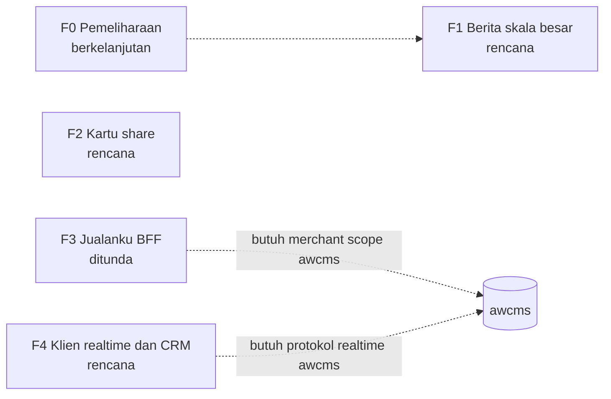

🇮🇩 Bahasa Indonesia · 🇬🇧 [English (source)](roadmap.md)

<!-- i18n-source-hash: sha256:eb52212f48382d43f1fbd1e5eb38510d9c3ade5625f35437f94648607cb1cfc7 -->

# awcms-astro — Roadmap

## Metadata

- Version: `v0.1.0`
- Last updated: `2026-11-08`
- Changeset: `Draf pertama roadmap di bawah standar roadmap dan issue lintas-portofolio internal (DL-041). Fase diambil dari backlog eksplisit README dan ADR yang diterima per 2026-11-08; urutan, status, dan kriteria keluar perlu konfirmasi pemilik.`

> **Draf menunggu konfirmasi pemilik.** Fase di bawah ini berasal dari bagian README "What does not exist yet" dan ADR di `docs/adr/`, dibaca pada 2026-11-08. Pelacak tidak punya issue terbuka pada tanggal itu. Belum ada yang disepakati dengan pemilik, setiap status ditandai **perlu konfirmasi pemilik**, dan tidak ada tanggal.

## Visi

awcms-astro adalah template keluarga AWCMS untuk situs publik statis di Astro, dengan `awcms` sebagai backend kontennya, ditambah permukaan admin USER opsional bila situs menyatakannya ([ADR-0034](adr/0034-publik-secara-bawaan-admin-hanya-bila-dinyatakan.md)). Karena ia template, cacat di sini ikut ke setiap situs yang lahir darinya. Roadmap ini mengurutkan yang masih belum ada: skala berita, kartu share yang dibangkitkan, portal Jualanku, serta pengalaman klien realtime dan CRM.

## Prinsip

- **Roadmap bukan janji tanggal.** Ia menyatakan urutan, tujuan, dan kriteria keluar. Tanggal, bila kelak ditambahkan, adalah sasaran indikatif yang boleh bergeser, dan pergeserannya dicatat.
- **Kriteria keluar menentukan "selesai"**, bukan daftar issue yang kosong.
- **Status hidup tinggal di GitHub**, bukan di berkas ini:

  ```bash
  gh api repos/ahliweb/awcms-astro/milestones --jq '.[] | "\(.title): \(.closed_issues) selesai, \(.open_issues) terbuka"'
  ```

- **Roadmap tidak menggantikan gerbang sebelum implementasi.** Fase yang mengubah standar dasar butuh ADR-nya lebih dulu (lihat `GOVERNANCE.md`); issue implementasi dibuat sesudahnya. Yang boleh lebih awal hanya issue `jenis:riset` dan spike yang ditandai.
- **Pertanyaan yang tetap berlaku** ([ADR-0023](adr/0023-penahanan-dipersempit-pekerjaan-tanpa-awcms.md)): apakah perubahan ini akan ditulis ulang bila `awcms` berubah? Bila ya, sebuah instans `awcms` harus membuktikan panggilannya lebih dulu.
- **Status** (hanya lima nilai): `rencana`, `berjalan`, `selesai`, `ditunda`, `dibatalkan`.
- Judul issue mengikuti `[Fase/SEQ] jenis: ringkasan`; pekerjaan di luar fase memakai `F0`. Label dan form dijelaskan di `CONTRIBUTING.md`.

## Fase

| Fase | Milestone | Tujuan | Kriteria keluar | Status | Issue |
| --- | --- | --- | --- | --- | --- |
| F1 | `F1 Seksi berita skala besar` | Seksi berita tetap layak dipakai saat memuat banyak artikel: paginasi, serta arsip kategori atau tag hanya untuk situs yang membutuhkannya | Diusulkan pemilik; draf: sebuah ADR menetapkan bentuk rute, setiap locale menghasilkan jumlah halaman yang sama, gerbang judul kembar tetap hijau, sampel Lighthouse diperbarui | `rencana` (perlu konfirmasi pemilik) | belum ada (menunggu ADR-nya). Dasar: [ADR-0033](adr/0033-seksi-berita-urutan-dari-tanggal-dan-dua-tanggal-yang-terpisah.md), [ADR-0036](adr/0036-news-adalah-kosakata-repo-ini-dan-sebuah-tab-yang-memikulnya.md) |
| F2 | `F2 Kartu share per halaman` | Kartu share 1200x630 dibangkitkan dari judul dan ilustrasi halaman | Diusulkan pemilik; draf: sebuah ADR menerima encoder gambar sebagai dependensi build, dan gerbang build tetap lolos | `rencana` (perlu konfirmasi pemilik) | belum ada (menunggu ADR-nya). Kartu yang diunggah sudah bekerja: [ADR-0026](adr/0026-kartu-share-per-artikel-dari-media-awcms.md) |
| F3 | `F3 Portal Jualanku (BFF)` | Sesi BFF sisi server untuk portal Jualanku | Diusulkan pemilik; draf: proof of concept terhadap instans `awcms` sungguhan, keputusan admission merchant scope di sisi `awcms`, dan jalur rollback statis yang sudah dicoba (tabel kesiapan di `docs/awcms-astro/jualanku/04-kesiapan.md`) | `ditunda` (perlu konfirmasi pemilik). Ditahan oleh uji [ADR-0023](adr/0023-penahanan-dipersempit-pekerjaan-tanpa-awcms.md) dan oleh belum adanya admission merchant scope di `awcms` | belum ada. Dasar: [ADR-0014](adr/0014-rendering-campuran-dan-bff-portal.md) |
| F4 | `F4 Klien realtime dan CRM publik` | Pengalaman klien lead publik, persetujuan, dan realtime yang disetujui, memakai yang disediakan `awcms` | Diusulkan pemilik; draf: protokol realtime `awcms` di hulu diterima lebih dulu, lalu tiap permukaan klien lolos gerbangnya sendiri | `rencana` (perlu konfirmasi pemilik). Kedua kontrak baru berupa dokumentasi usulan | tidak ada yang terbuka. Issue dokumentasi #123 dan #127 yang sudah ditutup menghasilkan `docs/bun-realtime-client-boundary.md` dan `docs/crm-public-ux-contract.md` |
| F0 | tanpa milestone (pemeliharaan) | Upgrade dependensi, perbaikan keamanan, dan pekerjaan rilis di luar fase | Tidak berlaku; F0 tidak punya akhir | berkelanjutan | perbaikan baru. Waktu rilis mengikuti [ADR-0048](adr/0048-a-release-is-cut-when-the-backlog-crosses-a-bound.md) |

**Bukan fase.** Filter locale pada feed `awcms` ada di hulu tetapi template ini tidak boleh memakainya; README menjelaskan alasannya. Ia sengaja tidak masuk roadmap.

## Ketergantungan antarfase



F1 dan F2 tidak bergantung satu sama lain maupun pada `awcms` sejauh yang ditunjukkan README. F3 dan F4 menunggu keputusan di `awcms`; pemilik mengonfirmasi urutannya.

## Ditunda dan dibatalkan

F3 berstatus `ditunda`, alasan dan syaratnya ada di tabel. Belum ada fase yang dibatalkan. Entri ditambahkan di sini beserta alasan dan tanggalnya; tidak dihapus dari tabel.

## Tinjauan

Tinjau roadmap ini setiap kali sebuah milestone selesai, prioritas berubah, atau ADR sebuah fase ditolak. Tinjauan memeriksa apakah kriteria keluar terpenuhi, apa yang bergeser dan mengapa, ke mana issue sisa dipindah, dan apakah fase berikutnya masih benar. Hasilnya satu entri Changelog dan kenaikan versi.

## Changelog

### 2026-11-08 - v0.1.0

- Draf pertama di bawah standar roadmap dan issue (DL-041). Empat fase dan F0 diambil dari backlog README dan ADR yang diterima; semua status perlu konfirmasi pemilik; tanpa tanggal.
