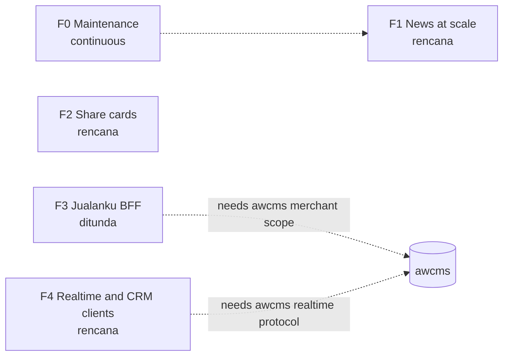

🇬🇧 English (source) · 🇮🇩 [Bahasa Indonesia](roadmap.id.md)

# awcms-astro — Roadmap

## Metadata

- Version: `v0.1.0`
- Last updated: `2026-11-08`
- Changeset: `First roadmap draft under the internal cross-portfolio roadmap and issue standard (DL-041). Phases are taken from the README's explicit backlog and the accepted ADRs on 2026-11-08; order, status and exit criteria need the owner's confirmation.`

> **Draft awaiting owner confirmation.** The phases below come from the README section "What does not exist yet" and the ADRs under `docs/adr/`, read on 2026-11-08. The tracker had no open issue on that date. Nothing here was agreed with the owner yet, every status is marked **needs owner confirmation**, and no dates are given.

## Vision

awcms-astro is the AWCMS family template for static public sites on Astro, with `awcms` as its content backend, plus an optional USER admin surface when a site declares it ([ADR-0034](adr/0034-publik-secara-bawaan-admin-hanya-bila-dinyatakan.md)). Because it is a template, a defect here travels to every site born from it. The roadmap orders what is still missing: news scale, generated share cards, the Jualanku portal, and realtime and CRM client experiences.

## Principles

- **A roadmap is not a promise of dates.** It states order, goal and exit criteria. A date, if one is ever added, is an indicative target that may move, and the move is recorded.
- **Exit criteria decide "done"**, not an empty issue list.
- **Live status lives on GitHub**, not in this file:

  ```bash
  gh api repos/ahliweb/awcms-astro/milestones --jq '.[] | "\(.title): \(.closed_issues) closed, \(.open_issues) open"'
  ```

- **The roadmap does not replace the gate before implementation.** A phase that changes a base standard needs its ADR first (see `GOVERNANCE.md`); implementation issues are created after it. Only `jenis:riset` issues and marked spikes may come earlier.
- **The question that still applies** ([ADR-0023](adr/0023-penahanan-dipersempit-pekerjaan-tanpa-awcms.md)): would this change be rewritten if `awcms` changed? If yes, an `awcms` instance must prove its calls first.
- **Statuses** (only these five): `rencana`, `berjalan`, `selesai`, `ditunda`, `dibatalkan`.
- Issue titles follow `[Fase/SEQ] jenis: ringkasan`; work outside any phase uses `F0`. Labels and forms are described in `CONTRIBUTING.md`.

## Phases

| Phase | Milestone | Goal | Exit criteria | Status | Issues |
| --- | --- | --- | --- | --- | --- |
| F1 | `F1 Seksi berita skala besar` | A news section stays usable when it holds many articles: pagination, and category or tag archives only for a site that needs them | To be proposed by the owner; draft: an ADR fixes the route shape, every locale produces the same page count, the duplicate-title gate stays green, the Lighthouse sample is updated | `rencana` (needs owner confirmation) | none yet (waits for its ADR). Basis: [ADR-0033](adr/0033-seksi-berita-urutan-dari-tanggal-dan-dua-tanggal-yang-terpisah.md), [ADR-0036](adr/0036-news-adalah-kosakata-repo-ini-dan-sebuah-tab-yang-memikulnya.md) |
| F2 | `F2 Kartu share per halaman` | A share card of 1200x630 is generated from a page's title and artwork | To be proposed by the owner; draft: an ADR admits the image encoder as a build dependency, and the build gates still pass | `rencana` (needs owner confirmation) | none yet (waits for its ADR). Uploaded cards already work: [ADR-0026](adr/0026-kartu-share-per-artikel-dari-media-awcms.md) |
| F3 | `F3 Portal Jualanku (BFF)` | A server-side BFF session for the Jualanku portal | To be proposed by the owner; draft: a proof of concept against a real `awcms` instance, the merchant-scope admission decision on the `awcms` side, and a tried static rollback path (readiness table in `docs/awcms-astro/jualanku/04-kesiapan.md`) | `ditunda` (needs owner confirmation). Held by the [ADR-0023](adr/0023-penahanan-dipersempit-pekerjaan-tanpa-awcms.md) test and by the missing merchant-scope admission in `awcms` | none yet. Basis: [ADR-0014](adr/0014-rendering-campuran-dan-bff-portal.md) |
| F4 | `F4 Klien realtime dan CRM publik` | Public lead, consent and approved realtime client experiences, consuming what `awcms` provides | To be proposed by the owner; draft: the upstream `awcms` realtime protocol is accepted first, then each client surface passes its own gates | `rencana` (needs owner confirmation). The two contracts exist as proposed documentation only | none open. The closed documentation issues #123 and #127 produced `docs/bun-realtime-client-boundary.md` and `docs/crm-public-ux-contract.md` |
| F0 | none (maintenance, no milestone) | Dependency upgrades, security fixes and release housekeeping outside a phase | Not applicable; F0 has no exit | continuous | new fixes. Release timing follows [ADR-0048](adr/0048-a-release-is-cut-when-the-backlog-crosses-a-bound.md) |

**Not a phase.** A locale filter on the `awcms` feed exists upstream but this template must not use it; the README explains why. It stays out of the roadmap on purpose.

## Phase dependencies



F1 and F2 are independent of each other and of `awcms` as far as the README shows. F3 and F4 wait on decisions made in `awcms`; the owner confirms the order.

## Postponed and cancelled

F3 is `ditunda` with its reason and conditions in the table. No phase is cancelled yet. Entries are added here with the reason and the date; they are not deleted from the table.

## Review

Review this roadmap whenever a milestone completes, priorities change, or a phase's ADR is rejected. The review checks whether the exit criteria are met, what moved and why, where the remaining issues go, and whether the next phase is still correct. The result is one Changelog entry and a version bump.

## Changelog

### 2026-11-08 - v0.1.0

- First draft under the roadmap and issue standard (DL-041). Four phases and F0 taken from the README backlog and the accepted ADRs; all statuses need owner confirmation; no dates.
